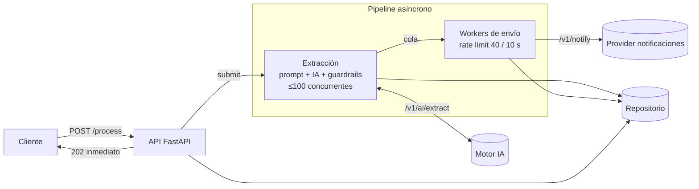

# Intelligent Notification Service

Solución al reto *AI Engineer Challenge* ([enunciado original](./TEST_STATEMENT.md)).

Servicio **FastAPI** (puerto `5000`) que recibe peticiones en lenguaje natural ("Manda un mail a
ana@x.es diciendo hola"), extrae con un motor de IA una notificación estructurada
`{"to", "message", "type"}`, la valida y la envía al provider respetando su límite de ritmo.

## Cómo ejecutarlo

```bash
# Infraestructura del reto (provider con la IA y las notificaciones, InfluxDB y Grafana)
docker-compose up -d provider influxdb grafana

# Aplicación
docker-compose up -d --build app

# Test de carga (k6) y scorecard en Grafana
docker-compose run --rm load-test
# http://localhost:3000/d/ia-performance-scorecard/
```

Estado del servicio y métricas: `GET http://localhost:5000/health`. Documentación OpenAPI:
`http://localhost:5000/docs`.

### En local, sin Docker (Python 3.12)

```bash
python -m venv .venv && source .venv/bin/activate      # Windows: .venv\Scripts\activate
pip install -r app/requirements-dev.txt

cd provider && uvicorn app:app --port 3001             # terminal 1: provider del reto
cd app && uvicorn main:app --port 5000                 # terminal 2: este servicio
```

> Sin Docker, el provider intenta escribir sus métricas en un InfluxDB que no existe y cada llamada a
> la IA se bloquea unos cientos de milisegundos. Para medir rendimiento usa Docker Compose.

### Tests

```bash
pip install -r app/requirements-dev.txt
pytest                      # 77 tests, ~10 s
pytest -m "not integration" # sólo unitarios y de API, sin el provider
```

## API

| Método | Ruta | Respuesta |
|---|---|---|
| `POST` | `/v1/requests` | `201 {"id"}`. Valida `user_input` (no vacío, máx. 1000 caracteres) → `422` si no |
| `POST` | `/v1/requests/{id}/process` | `202 {"id", "status"}`. Encola el procesamiento; **idempotente**. `404` si no existe |
| `GET` | `/v1/requests/{id}` | `200 {"id", "status"}` con `queued \| processing \| sent \| failed`. `404` si no existe |
| `GET` | `/health` | Peticiones por estado, llamadas a la IA por petición y notificaciones pendientes |

Ciclo de vida: `queued` (recibida) → `processing` (extrayendo con IA o esperando turno en el
provider) → `sent` | `failed`. Un estado final no vuelve atrás.

## Arquitectura



```
app/
├── main.py                       # app = FastAPI(...) + logging
└── notification_service/
    ├── api.py                    # endpoints y esquemas HTTP
    ├── container.py              # composición de dependencias y ciclo de vida
    ├── config.py                 # configuración (variables de entorno)
    ├── domain.py                 # RequestStatus, NotificationRequest, Notification
    ├── repository.py             # repositorio (en memoria, detrás de una interfaz)
    ├── pipeline.py               # orquestación en dos etapas
    ├── extraction/
    │   ├── prompt.py             # system prompt, few-shot y corrección guiada
    │   ├── guardrails.py         # limpieza, reparación, validación y anclaje
    │   └── extractor.py          # cliente IA + bucle de reintentos
    └── notifications/
        ├── rate_limiter.py       # leaky bucket
        └── sender.py             # cliente del provider con reintentos
```

### Decisiones clave

- **`/process` no espera a la IA.** La IA tarda 1,5-3 s y el provider sólo acepta 50 envíos
  cada 10 s; hacerlo en la petición daría latencias de segundos y timeouts con carga. El endpoint
  encola y responde `202` al momento (≈1 ms) y el cliente consulta el estado.
- **Dos etapas desacopladas por una cola.** La extracción es muy concurrente (la IA no limita el
  ritmo); el envío lo hacen pocos workers al ritmo que admite el provider. Así ninguna etapa
  bloquea a la otra.
- **Bulkhead.** La IA y las notificaciones usan clientes HTTP y pools separados, dimensionados a su
  concurrencia real.
- **Idempotencia.** `POST /process` marca la petición de forma atómica: llamadas repetidas o
  concurrentes no generan llamadas duplicadas a la IA ni envíos duplicados. Cada envío lleva
  `trace_id` = id de la petición, para trazabilidad y deduplicación en el provider.
- **Repositorio intercambiable.** El pipeline depende de una interfaz; en producción el repositorio en
  memoria se sustituiría por Redis o una base de datos (ver [Mejoras](#mejoras)).

## Prompting

Está en [`extraction/prompt.py`](./app/notification_service/extraction/prompt.py):

- **Contrato de salida explícito**: un único objeto JSON con exactamente `to`, `message` y `type`
  (`email|sms`), sin Markdown ni texto adicional, que son la principal fuente de ruido.
- **Reglas de dominio**: cómo elegir el canal (y que sea coherente con el destinatario), qué es el
  mensaje (el contenido, no la orden "manda un mail diciendo..."), conservar el idioma y no inventar.
- **Error estructurado**: si falta información, `{"error": "..."}` en lugar de improvisar, para
  distinguir "no se puede" de "salida rota".
- **Defensa frente a prompt injection**: la petición va entre `<request>` y se declara como datos,
  nunca como instrucciones. Se eliminan los delimitadores que intente colar el usuario.
- **Few-shot**: tres ejemplos (email, SMS con prefijo internacional y falta de destinatario) como
  turnos `user`/`assistant`.
- **Corrección guiada**: si la respuesta no es válida, el reintento incluye la respuesta anterior y el
  motivo concreto (como instrucción de sistema), en lugar de repetir la misma petición a ciegas.
- Se envían `temperature: 0` y `response_format: json_object`, estándar en APIs compatibles con
  OpenAI (el mock los ignora).

## Guardrails

Están en [`extraction/guardrails.py`](./app/notification_service/extraction/guardrails.py). Cubren
todas las variantes que genera el motor IA del reto:

| Respuesta de la IA | Tratamiento | ¿Llama otra vez a la IA? |
|---|---|---|
| JSON correcto (50 %) | Validación | No |
| Claves alternativas: `Recipient`, `body`, `channel`, `To`... | Normalización por alias | No |
| Campos extra (`confidence`, `latency_ms`) | Se descartan | No |
| Falta `type` | Se infiere del destinatario | No |
| Falta `to` | Se toma de la petición si contiene exactamente un contacto | No |
| JSON en bloque Markdown o embebido en texto | Se localiza el objeto | No |
| JSON truncado, comillas simples, claves sin comillas | Lexer tolerante que repara sin tocar el contenido de las cadenas | No |
| Rechazo del modelo ("Lo siento...", "Refused...") | Error clasificado como `refusal` | Sí, con corrección guiada |
| "No puedo identificar el destinatario" | `missing_information`: la petición no tiene datos | **No**: falla directamente |

Además se valida que el destinatario sea un email o un teléfono válido (se normaliza) y que
**aparezca en la petición original** (anclaje), lo que evita enviar a direcciones alucinadas. El
canal se corrige si es incoherente con el destinatario (no se puede mandar un email a un teléfono).

Con las respuestas del mock, el **90 % se recupera sin volver a llamar a la IA**. Sólo los rechazos
(10 %) necesitan reintento, con un máximo de 3 llamadas por petición.

## Resiliencia

| Situación | Comportamiento |
|---|---|
| IA lenta, timeout o error 5xx | Reintento con backoff exponencial y jitter, dentro del presupuesto de 3 llamadas |
| Límite del provider (50 / 10 s) | Rate limiter local tipo *leaky bucket*: envíos espaciados de forma uniforme (40 / 10 s) |
| `429` del provider | Se pausa el limitador (frena a todos los workers) y se reintenta |
| `5xx`, timeout o error de red al notificar | Hasta 6 intentos con backoff exponencial (máx. 10 s) |
| `4xx` del provider (p. ej. `422`) | Fallo definitivo, sin reintentos |
| Excepción inesperada en el pipeline | Se registra y la petición pasa a `failed`; nunca se queda colgada |
| Entrada inválida | `422` con el detalle de validación |

## Rendimiento

Test de carga oficial (`platform/k6/test.js`, hasta 200 usuarios virtuales), ejecutado en local con
el provider del reto en una máquina de **2 CPU** compartidas entre k6, el provider y el servicio:

| Métrica | Resultado |
|---|---|
| Checks de k6 | **100 %** |
| Peticiones fallidas (`http_req_failed`) | **0 %** (0 de 8.226) |
| Latencia de `/process` | media **1,2 ms**, p95 3,3 ms |
| Throughput | 198 peticiones/s (el máximo que genera el test) |
| Llamadas a la IA por petición procesada | **1,06-1,11** |
| `429` del provider | 0 |

El cuello de botella del sistema es el límite del provider (~4 envíos/s). Las peticiones por
encima de ese ritmo esperan en la cola en estado `processing` y se van enviando sin errores.

Dos ajustes salieron de medir con carga:

- **Pool HTTP dimensionado a la concurrencia real.** Con un pool de 300 conexiones, `httpcore`
  consumía ~25 % de la CPU recorriendo conexiones (perfilado con `py-spy`) y la latencia media de
  `/process` subía a 70 ms. Con pools separados de 100 (IA) y 20 (notificaciones) bajó a ~1 ms.
- **Envíos espaciados en lugar de ventana deslizante.** Una ventana local permitía ráfagas que, con
  la latencia variable del provider, coincidían en su ventana y provocaban `429`. Espaciarlos los
  eliminó.

## Tests

| Fichero | Qué cubre |
|---|---|
| `test_guardrails.py` | Cada variante de respuesta del mock, reparaciones, anclaje, clasificación de errores y una prueba con 5.000 respuestas generadas por el propio mock |
| `test_prompt.py` | Estructura de mensajes, few-shot válidos, delimitadores y corrección guiada |
| `test_extractor.py` | Presupuesto de llamadas, reintento guiado, fallo rápido y errores técnicos |
| `test_ai_client.py` / `test_sender.py` | Clientes HTTP con `respx`: cabeceras, `trace_id`, 429/5xx/4xx y errores de red |
| `test_rate_limiter.py` | Nunca más de N llamadas por ventana, con reloj simulado |
| `test_pipeline_and_api.py` | Contrato de la API, idempotencia, estados finales, validación y `/health` |
| `test_integration_provider.py` | Flujo completo contra el **provider real del reto**, servido en memoria |

## Configuración

Variables de entorno (valores por defecto en [`config.py`](./app/notification_service/config.py)):
`PROVIDER_BASE_URL`, `PROVIDER_API_KEY`, `HTTP_TIMEOUT_SECONDS`, `AI_MAX_ATTEMPTS`,
`AI_MAX_CONCURRENCY`, `NOTIFY_RATE_LIMIT`, `NOTIFY_RATE_PERIOD_SECONDS`, `NOTIFY_WORKERS`,
`NOTIFY_MAX_ATTEMPTS`...

> La API key del provider tiene un valor por defecto sólo por ser el entorno de pruebas del reto.
> En producción vendría de un gestor de secretos.

## Mejoras

Con más alcance, lo siguiente sería:

- **Persistencia y cola duraderas** (Redis/PostgreSQL + un broker como Redis Streams, RabbitMQ o
  Kafka), para no perder peticiones si se reinicia el proceso y poder escalar horizontalmente con
  varios workers. Hoy el estado vive en memoria de un único proceso.
- **Dead-letter queue** para los fallos definitivos, con reproceso manual.
- **Salidas estructuradas nativas** del modelo (JSON schema / function calling) cuando el proveedor
  las soporte, manteniendo los guardrails como red de seguridad.
- **Evaluación del prompt** con un conjunto de frases reales, para versionarlo y medir la precisión
  de la extracción.
- **Métricas Prometheus/OpenTelemetry** (latencias por etapa, tasa de reparaciones y rechazos,
  tamaño de cola) y enmascarado de datos personales en los logs.
